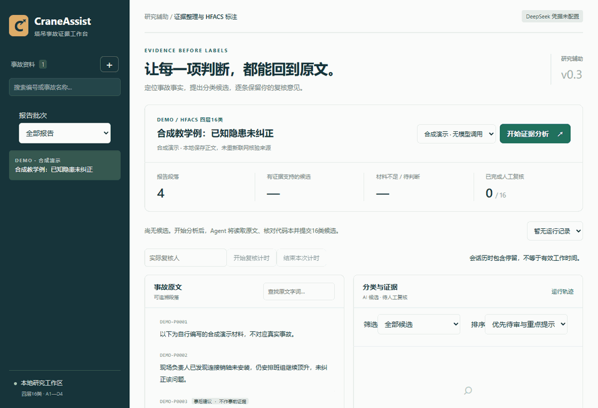
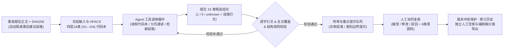

# CraneAssist：证据驱动的 HFACS 辅助标注 Agent

> **一句话定位：** 面向塔吊事故报告人因分析的证据驱动型 Agent 与人机协同（Human-in-the-loop）复核工作台——将 HFACS 四层 16 类（A1—D4）分类体系编码为工具调用与程序化校验约束，强制每条结论附带逐字连续引文，并与人工独立标注严格隔离。



## 核心亮点

- **HFACS 四层 16 类（A1—D4）规则约束与工具闭环：** 将施工安全领域四层 16 类代码本编码为 Agent 约束——模型须通过 `get_codebook`、`read_passages`、`search_passages` 通读全部段落后再调用 `submit_candidates` 提交 16 类结论；证据不足时必须标为 `unknown`，自动标记并隔离“事后整改建议”段落，防止将事后建议误作事前致因。
- **逐字引文核验与不合格打回机制：** 程序对模型提交的每条候选校验段落编号（`span_id`）、原文 SHA-256 及原文连续子串匹配；一旦出现引文篡改、漏读段落或结构违规即打回模型继续修订，并基于证据结构与类别边界自动生成重点复核提示队列。
- **Human-in-the-loop 协同复核与真值防污染：** 本地工作台支持原文段落一键跳转高亮、待审/重点提示筛选、接受/修改/驳回（强制关联 6 类结构化修改原因码）、版本冲突保护、完整修订历史与复核会话计时；**查看 AI 前的独立人工空白标注表**与 **AI 辅助复核稿**分别导出并绑定 `MANIFEST` 哈希，杜绝 AI 先验污染人工独立判断。
- **批次幂等恢复与工程实测：** 支持多报告批次输入与代码本哈希冻结、文件锁、断点恢复与显式失败重试；在本地真实事故报告上完成 `deepseek-flash` 批量运行验证（生成 **64 条带逐字证据的待复核候选**，并完整保留因引文不精确被打回直至触发软 Token 阈值停止的边界轨迹）；全仓通过 **34 项工程自动化测试**（公开仓库仅含合成教学例 `DEMO`，不含真实事故报告或个人复核记录）。

## 系统架构



## 快速开始（零密钥合成演示 ≤ 5 条命令）

```powershell
python -m venv .venv
.\.venv\Scripts\python.exe -m pip install -e ".[dev]"
.\.venv\Scripts\python.exe -X utf8 scripts/seed_demo.py
.\.venv\Scripts\python.exe -X utf8 -m craneassist.cli run --case DEMO --provider demo
.\.venv\Scripts\python.exe -m craneassist.cli serve --port 8012
```

打开 <http://127.0.0.1:8012> 即可在零密钥合成教学例 `DEMO` 上体验证据定位、重点提示筛选与人工复核流程。

## 文档导航

- **架构、演示与项目规范：** [项目上下文](PROJECT_CONTEXT.md) · [三分钟演示与面试](docs/SHOWCASE.md) · [项目规则](AGENTS.md)
- **复核工作流与批次协议：** [v0.3 复核队列与原因码说明](docs/REVIEW_V03.md) · [v0.2 批次冻结与独立导出说明](docs/PILOT_V02.md) · [HFACS 四层 16 类代码本出处](src/craneassist/resources/codebook_provenance.json)

---

将事故报告整理为可定位的事实与 A1—D4 四层16类候选，逐字核对引文，再交给人工接受、修改或驳回。原文、模型候选和人工判断分别保存。

面向大模型应用开发的独立 Python / FastAPI 项目，核心链路显式实现：

演示与设计取舍见[三分钟展示](docs/SHOWCASE.md)。2026-10-28完整34项工程测试通过，真实人工评测仍待完成。

```text
来源与正文哈希 → 工具读取全部段落 → 提交16类候选 → 引用与结构检查
             → 人工复核及修改历史 → 可追溯导出
```

- 工具调用：读取代码本、分页阅读、检索段落、提交候选；校验错误返回模型继续修订。
- 原文不可变，来源、段落编号和 SHA-256 随候选保留；材料不足使用 `unknown`。
- 批次冻结输入和代码本，操作系统锁、恢复与显式失败重试保留全部尝试。
- 独立人工空表和辅助复核稿分别导出；复核有版本检查、修改历史及会话计时。
- v0.3新增待复核／重点提示筛选、复核排序、六类修改原因及当前原因计数；提示优先级来自证据结构与类别边界检查。
- CLI 与本地网页，默认仅监听 `127.0.0.1:8012`。

## 零密钥演示

公开仓库不包含真实事故正文、研究批次、个人复核记录或含正文的运行报告。可直接创建合成教学例体验完整流程：

```powershell
git clone https://github.com/INeedSomeSugar/craneassist.git
cd craneassist
python -m venv .venv
.\.venv\Scripts\python.exe -m pip install -e ".[dev]"
.\.venv\Scripts\python.exe -X utf8 scripts/seed_demo.py
.\.venv\Scripts\python.exe -X utf8 -m craneassist.cli run --case DEMO --provider demo
.\.venv\Scripts\python.exe -m craneassist.cli serve --port 8012
```

打开 <http://127.0.0.1:8012>，选择 DEMO 和“合成演示”，查看段落、候选、引用及人工复核。此模式使用固定脚本，不调用模型。`seed_demo.py` 不读取论文目录，重复执行保留已有 DEMO。

使用自己的报告时，可在网页导入文本。选择 DeepSeek 会发送该报告正文并消耗 API 用量；调用前自行确认数据可发送。密钥仅来自进程环境或未提交的 `.env`；配置示例见 `.env.example`。

## 验证与设计边界

工程测试覆盖引文篡改、段落覆盖、状态完整性、复核冲突、批次恢复和导出。运行：

```powershell
.\scripts\check.ps1
```

v0.3 已完成34项工程测试；本地浏览器在独立合成例上实际验证筛选、保存修改原因、队列更新和结果展示，见 [复核工作流说明](docs/REVIEW_V03.md)。本地历史真实模型样例读取86段、生成16类候选，用量25,487 tokens，验证了调用与证据追溯流程；原始资料和报告保留本地。当前没有人工真值比较、分类准确率或效率提升结论。

逐字引用与结构通过不等于分类正确；会话历时包含停留。专家验证、独立标注和训练评测准入不会随复核条数自动开启。独立人工判断应在查看 AI 候选前由实际人员填写。

代码本保留已确认的 Zhou–Lei 四层16类名称和本课题操作边界，出处与摘要见 `src/craneassist/resources/codebook_provenance.json`；操作边界仍需人工审阅。完整批次操作见 [PILOT_V02.md](docs/PILOT_V02.md)，本地研究状态见 [PROJECT_CONTEXT.md](PROJECT_CONTEXT.md)。PDF/OCR、联网取证和真实准确率评测尚未实现。
