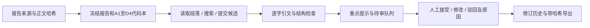

# 三分钟演示与面试

## 问题与架构

事故报告的证据位置和分类判断需要保留可追溯关系。系统将原文、AI候选与人工决定分别保存，并允许证据不足时使用unknown。

## 演示顺序

1. 按README运行`seed_demo.py`并以demo provider执行DEMO；只使用合成教学例，不调用模型。
2. 打开本地网页，检查段落与候选的定位，筛选重点提示和待审项；说明排序源于结构规则，不是模型置信度。
3. 在独立合成目录演示修改为unknown、记录原因和保存；观察队列与当前原因计数，说明修改历史和版本冲突保护。
4. 展示合成导出，解释来源摘要、原文定位、候选和人工判断的关系。真实事故资料、个人复核记录与含正文截图留本地。

## 应能解释的取舍

- 引文必须逐字来自保存的来源；后果、事后建议和证据不足不能自动当作事前致因。
- 固定批次恢复时跳过完成项，失败需显式重试，保留所有尝试和用量；输入或代码本变化时拒绝沿用。
- 独立人工表应在实际人员看AI前填写；之后的辅助复核另记。仅生成空表不能证明独立性。
- 会话历时包含停留，不等于有效标注用时或效率收益；工程检查不自动开启专家验证和训练准入。

2026-10-28完整34项工程测试通过。历史真实模型样例验证了调用与证据追溯；当前五报告批次的模型运行及真实人工评测仍待数据发送同意和实际复核，不能宣传分类准确率。
